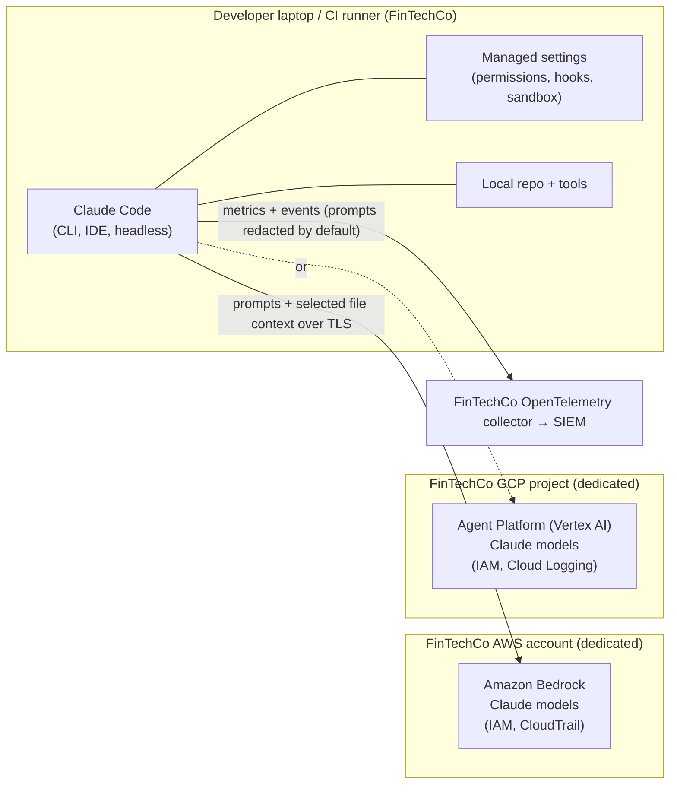

# Security and compliance brief: Claude Code at FinTechCo (D7)

**Executive summary**
1. Claude Code can run entirely through FinTechCo's own AWS (Amazon Bedrock) or GCP (Google Cloud's Agent Platform, formerly Vertex AI) accounts, under FinTechCo's IAM, budgets and logging [CLM-614] [CLM-686] [CLM-687].
2. What it may read, run and change is set by central policy that developers cannot override, enforced in code by permission rules, hooks and an OS-level sandbox that the policy switches on, and every action can be exported to the SIEM [CLM-675] [CLM-677] [CLM-611] [CLM-607] [CLM-612].
3. Under Anthropic's commercial terms, customer content is not used to train models [CLM-600]; Anthropic lists SOC 2 Type I and II, ISO 27001:2022 and ISO/IEC 42001:2023, and the reports are available through its Trust Center for your team to review [CLM-618].

## 1. Where data goes

- **What leaves the machine:** the prompt and the file context Claude Code reads for the task, sent over TLS 1.2+ [CLM-604] to the model endpoint FinTechCo configures. With Bedrock or Vertex, calls are made with FinTechCo's own cloud credentials and IAM and billed to FinTechCo's account [CLM-614]. Anthropic's legal page says an existing commercial agreement with Anthropic covers usage through those clouds unless agreed otherwise [CLM-614]; FinTechCo has no agreement yet, so its counsel should confirm what governs a cloud deployment.
- **On Bedrock:** AWS states that model providers, including Anthropic, have no access to Bedrock logs or to customer prompts and completions; retention is set per Region, and a few newer models require AWS-side retention for review, so check the specific model before approving it [CLM-615].
- **Direct with Anthropic (Teams/Enterprise/API):** standard retention is 30 days; zero data retention is available to qualified Enterprise organizations [CLM-602] [CLM-603].
- **On the laptop:** session transcripts are kept locally for 30 days by default, adjustable with `cleanupPeriodDays` [CLM-602]; telemetry, error reporting and /feedback are off by default when routed through Bedrock or Google Cloud; on the direct route an administrator switches off non-essential traffic with `CLAUDE_CODE_DISABLE_NONESSENTIAL_TRAFFIC`. Operational metrics never include code, prompts or file paths [CLM-605].
- **Open item to verify before production:** the retention and logging terms for Claude on Google Cloud's Agent Platform are not confirmed in our research; FinTechCo's GCP team should check them in its Google contract.

## 2. Controls FinTechCo sets centrally

| Control | What it does | Source |
| --- | --- | --- |
| Managed settings | Highest-precedence policy delivered by the admin console, MDM or a file; developers cannot override managed keys. The admin-console route is bypassed when Bedrock or Vertex is configured, so use MDM or a file there | [CLM-675] [CLM-659] [CLM-676] |
| Permission rules and modes | Deny / ask / allow rules for tools, files and commands; deny wins; policy sets the starting mode (Manual for the pilot) and can disable auto and bypass modes | [CLM-606] [CLM-013] [CLM-677] |
| Hooks | Programs that run before or after tool calls and can block them (e.g., the PCI card-number guard in the demo); restrict to managed hooks only | [CLM-611] [CLM-677] |
| Sandbox | Optional and off by default; FinTechCo requires it in managed settings. OS-enforced limits on shell commands' file writes and network domains (shell only; file tools, MCP and hooks run outside it) | [CLM-607] |
| MCP server allowlist | By default anyone can connect any MCP server; managed settings restrict servers by URL or command | [CLM-678] [CLM-679] [CLM-610] |
| Model and version pinning | Allowed models, minimum and maximum versions; on Bedrock/Vertex these managed settings are the route | [CLM-689] [CLM-688] |
| Telemetry and audit | OpenTelemetry metrics and events, including every permission decision, to FinTechCo's collector; prompts redacted unless enabled; request-level logs through a gateway or CloudTrail | [CLM-612] [CLM-684] [CLM-613] |
| Spend controls | Cloud budgets on Bedrock/Vertex; spend limits by group on Teams/Enterprise | [CLM-620] [CLM-685] |

The demo shows these working: `.env` reads denied, a card number blocked by a hook, every tool call written to an audit log (`demo/fallback/governance/verification.md`). Hooks are one layer. CI secret and PAN scanning, the sandbox and human code review remain the backstop.

## 3. How this supports FinTechCo's obligations
Claude Code does not make FinTechCo compliant; it fits into the controls FinTechCo already runs. Mapping to confirm with Compliance and Internal Audit (illustrative and our judgment, not legal advice or a sourced claim):

| Obligation | What applies to an AI coding tool | How Claude Code supports it |
| --- | --- | --- |
| PCI DSS | Cardholder data must not leak into code, logs or prompts | Deny rules on secrets and data paths; PAN-blocking hook; sandbox; synthetic test data only; telemetry prompts redacted by default |
| SOX IT general controls (change management) | Every production change is reviewed and approved | Claude Code proposes; humans review and merge; push can be denied by policy; commits and PRs carry attribution by default [CLM-664] |
| GLBA Safeguards Rule, NYDFS Part 500 | Vendor oversight, access control, logging, incident response for customer information | Runs in FinTechCo's cloud accounts with its IAM; central policy; OpenTelemetry and CloudTrail into the SIEM; no customer data needed for coding work |
| Interagency third-party risk guidance; FFIEC | Due diligence and ongoing monitoring of the vendor | Trust Center reports [CLM-618]; commercial terms on data use and IP [CLM-600] [CLM-601]; usage and policy monitoring |
| SR 11-7 model risk management | Fraud and credit models need validation and documentation | Claude Code is a development tool, not a decisioning model; code it writes for models goes through the same validation; measure time to validated model (MET-15) |
| Fair lending (ECOA/Reg B) explainability | Credit decisions must be explainable | No change to model governance; AI-written feature code is reviewed like any other |

## 4. Questions to close in the security review
1. Delivery route: Bedrock, Vertex, or Claude for Enterprise (with or without ZDR)?
2. Which repositories and data classes are in scope for the pilot (start with no cardholder-data environments)?
3. Which MCP servers are approved, if any, for the pilot?
4. SIEM fields and alerting for policy events (MET-10).
5. Request Anthropic's SOC 2 Type II report and ISO certificates under NDA and review their scope [CLM-618].
